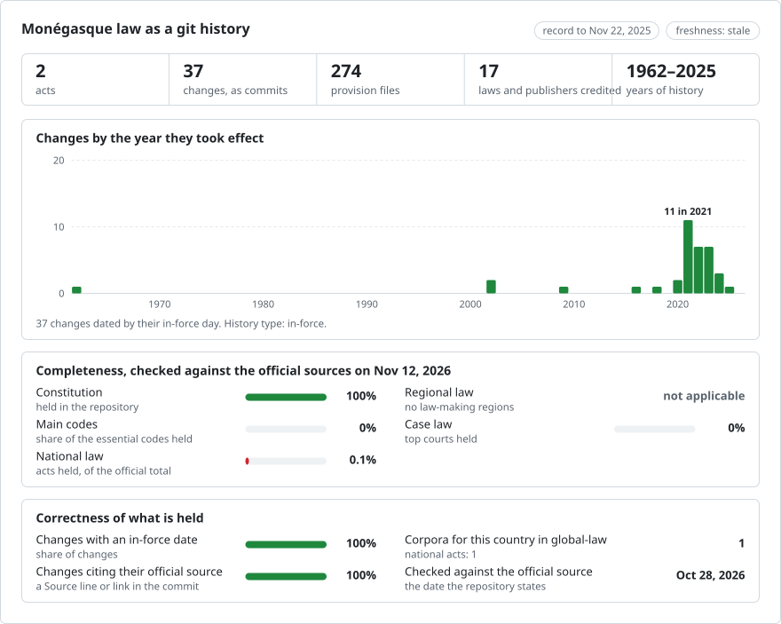

# Monaco: law history in git

**English** · **[Ou lisez-le en français](README.md)**

<picture>
<source media="(prefers-color-scheme: dark)" srcset="data/effort-dark.svg">

</picture>

The law of Monaco as a git history: one file per article, one commit per version on the day it took effect, and the act that made each change as the commit's author. `git blame` names the act behind every article; `git log` lists every change to an article; picking a date gives the text in force that day.

Part of [lexifina/global-law](https://github.com/lexifina/global-law), one git history for every country's law: this is Monaco's national law, which global-law reads at `monaco/national/acts/`.

**What is in it now:** the Constitution and 10 codes (among them the Code civil, the Code pénal, both procedure codes and the Code de commerce), 673 lois and ordonnances-lois, 6,303 ordonnances souveraines, arrêtés and other regulatory texts, and 497 treaties, from Legimonaco with every consolidated version it publishes (13,289 dated versions). The layout is in [STRUCTURE.md](STRUCTURE.md).

Each act is a folder with one file per article: `constitution/article-53.md` is Article 53 of the Constitution and `codes/code-civil/titre-preliminaire/article-2.md` Article 2 of the Code civil; `intitule.md` holds an act's title and `constitution/preambule.md` the preamble.

The text is in French, Monaco's only official language, as Legimonaco publishes it. An English translation is not part of this record.

## Questions as git commands

| Question | Command |
| --- | --- |
| Every change to Article 1 of loi n° 1.362 | `git log --follow -p --word-diff -- lois/2009/1.362-relative-a-la-lutte-contre-le-blanchiment-de/article-1er.md` |
| Which act wrote each line of Article 1? | `git blame lois/2009/1.362-relative-a-la-lutte-contre-le-blanchiment-de/article-1er.md` |
| Every version of loi n° 1.362, with the day each took effect | `git log --format="%h %(trailers:key=In-force,valueonly,separator=) %an" --follow -- lois/2009/1.362-relative-a-la-lutte-contre-le-blanchiment-de/article-1er.md` |
| Article 1 of the Code civil as in force on 1 January 2018 | `python tools/en_vigueur_au.py 2018-01-01 codes/code-civil/titre-preliminaire 1` |

**Outside git**, we also host this record publicly, for free:

- **[Ask Claude about Monegasque law](https://global-law.lexifina.com/v1/try_claude?country=monaco)**: opens Claude with a first question ready.
- **[Ask ChatGPT](https://global-law.lexifina.com/v1/try_chatgpt?country=monaco)**: the same question in ChatGPT.
- **[Search Monegasque law on our site](https://lexifina.com/law?country=monaco&q=blanchiment+de+capitaux)**: a search for "blanchiment de capitaux", with each provision's text and its versions, no account needed.
- **[Developer REST API](https://global-law.lexifina.com/v1/search_law?query=blanchiment+de+capitaux&jurisdiction=monaco)**: the same search as JSON, with no key. See the [documentation here](https://lexifina.com/api/global-law).

Both assistants read the record through the free Global law connector (MCP, `https://global-law.lexifina.com/mcp`); the first time, the chat gives you the link that adds it. Ask in French or in English.

**Host it yourself easily.** All it takes is git and Python, and the tools run on your machine:

```sh
git clone --depth 1 https://github.com/lexifina/global-law && cd global-law
python3 tools/countries.py add monaco/national/acts
python3 tools/law.py show 2026-01-01 monaco/national/acts/lois/2009/1.362-relative-a-la-lutte-contre-le-blanchiment-de/article-1er.md
```

Opened in Claude Code, Cursor, VS Code or Codex, the clone also starts a local MCP server with the same tools ([MCP.md](https://github.com/lexifina/global-law/blob/main/MCP.md)).

## Dates

Each commit is dated at noon, Europe/Monaco, on the day the version took effect, and carries it in its `In-force:` trailer:

- the day Legimonaco gives each consolidated version (`<text>@YYYY.MM.DD`), the day its text applies from; a law's own dates are in `Enacted:` (the day the Prince signed it) and `Published:` (the Journal de Monaco, from the day after which it binds third parties, Constitution, Art. 69);
- where an article's own history gives its change another day than the version that prints it, that day is in `Law-in-force:`;
- git cannot store dates before 1970, so the Constitution's 1962 text is dated 1970-01-01, with the real day in `In-force:` and the tag `constitution/1962-12-17`. Ask for a date with `tools/en_vigueur_au.py`, not `git log --before`.

Each change is credited to the act that made it, as Legimonaco names it (`Loi n° 1.462 du 28 juin 2018`), from each article's "Historique de consolidation" (`Evidence:` says how). Changes no single act explains are credited to `Legimonaco` and labelled `Kind: typesetting`, `Kind: reverted` or `Kind: unexplained` (45 of 501 article changes).

## How it is checked

- `tools/check_repo.py` reads each of the 20 versions back from git on the day it applies from and compares every file, byte for byte, with the text rebuilt from that version's Legimonaco page (its sha256 in `data/versions.json`).
- It then compares the whole act, word for word, with the page read independently of the parser.
- `tools/test_repo.py` checks blame, the dated tool before and after known amendments, `git log --follow`, the tags and the trailers.
- Rebuilt from the same pages, the build gives the same commit hashes. The results are in [`REPRODUCE.md`](REPRODUCE.md).
- [vulnerabilities/](vulnerabilities/README.en.md): possible drafting mistakes in this law, found by global-law's detectors and checked by hand. Not run yet.

## What it does not show

- **Case law and bills.** Decisions and travaux législatifs are not in this repository.
- **Texts Legimonaco shows only as repealed, with no text**, and versions that apply after the build day.
- **The 1911 Constitution**, which Legimonaco has only as a PDF attached to the 1962 text.
- **Text between Legimonaco's versions.** The record has exactly the versions Legimonaco publishes, including those that print a change early or print an earlier text again (see `REPRODUCE.md`).
- **Division headings, histories and editorial notes**, left out of the article files (each act's `README.md` lists its headings).

## Sources

| Source | Kind | Past versions | Notes |
| --- | --- | --- | --- |
| [Legimonaco](https://legimonaco.mc) (Gouvernement Princier) | Official legal database: consolidated texts and each article's history | yes, every consolidated version | Only the Journal de Monaco is authoritative |

## Licence

See [`LICENSE`](LICENSE). Under Monaco's copyright law, laws and official publications are not protected (Loi n° 491 du 24 novembre 1948, article 38); only the words of the law are reproduced, unchanged, without Legimonaco's editorial notes. Lexifina's own contributions are CC0 1.0.

Legimonaco's terms of use ([CGU](https://legimonaco.mc/CGU.html)) allow its data to be reused free of charge only; this repository is public and free, and nothing in it is sold. 

No AI model wrote or changed legal text; the scripts were written by an AI model (see [`REPRODUCE.md`](REPRODUCE.md)).

## Visualisations

- [visualisations/](visualisations/README.en.md): charts drawn from this repository. Not drawn yet.

## More

From [lexifina/global-law](https://github.com/lexifina/global-law):

- [FEATURES.md](https://github.com/lexifina/global-law/blob/main/FEATURES.md): every feature, and what every corpus must support (`git blame`, `law.py`, the MCP tools)
- [FAQ.md](https://github.com/lexifina/global-law/blob/main/FAQ.md): questions and answers · [CONTRIBUTING.md](https://github.com/lexifina/global-law/blob/main/CONTRIBUTING.md): proposing changes · [MCP.md](https://github.com/lexifina/global-law/blob/main/MCP.md): the MCP server · [REPRODUCE.md](https://github.com/lexifina/global-law/blob/main/REPRODUCE.md): how it was built · [CHANGELOG.md](https://github.com/lexifina/global-law/blob/main/CHANGELOG.md)
- [FRESHNESS.md](https://github.com/lexifina/global-law/blob/main/FRESHNESS.md): how current each corpus is · [Monitoring](https://github.com/lexifina/global-law/tree/main/monitoring): whether updates are running · [WATCHING.md](https://github.com/lexifina/global-law/blob/main/WATCHING.md): how each official source is watched for changes
- [performance/](https://github.com/lexifina/global-law/tree/main/performance): how fast the tools are, measured
- [visualisations/](https://github.com/lexifina/global-law/tree/main/visualisations): charts and bridges across the world's law
- [Vulnerabilities](https://github.com/lexifina/global-law/tree/main/vulnerabilities): mistakes in legislation as published
