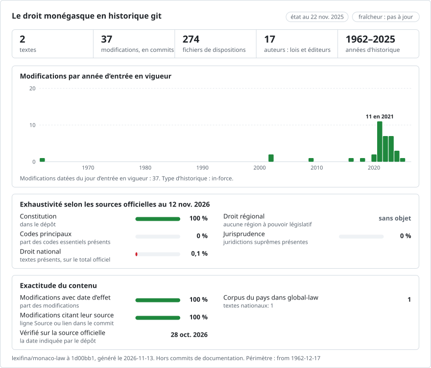

# Monaco : l’histoire du droit dans git

**Français** · **[Or read it in English](README.en.md)**

<picture>
<source media="(prefers-color-scheme: dark)" srcset="data/fr/effort-dark.svg">

</picture>

Le droit monégasque sous forme d’historique git : un fichier par article, un commit par version au jour de son entrée en vigueur, et pour auteur de chaque commit l’acte qui a fait la modification. `git blame` nomme l’acte à l’origine de chaque article ; `git log` énumère chaque modification d’un article ; le choix d’une date donne le texte en vigueur ce jour-là.

Fait partie de [lexifina/global-law](https://github.com/lexifina/global-law), un historique git unique pour le droit de chaque pays : ce dépôt contient le droit national monégasque, que global-law lit dans `monaco/national/acts/`.

**Ce qu’il contient aujourd’hui :** la Constitution et 10 codes (dont le Code civil, le Code pénal, les deux codes de procédure et le Code de commerce), 673 lois et ordonnances-lois, 6 303 ordonnances souveraines, arrêtés et autres textes réglementaires, et 497 traités, issus de Legimonaco avec toutes les versions consolidées qu’il publie (13 289 versions datées). La structure est décrite dans [STRUCTURE.md](STRUCTURE.md).

Chaque texte est un dossier, un fichier par article : `constitution/article-53.md` est l’article 53 de la Constitution et `codes/code-civil/titre-preliminaire/article-2.md` l’article 2 du Code civil ; `intitule.md` contient l’intitulé d’un texte et `constitution/preambule.md` le préambule.

Le texte est en français, seule langue officielle de Monaco, tel que Legimonaco le publie. Une traduction anglaise ne fait pas partie de ce registre.

## Les questions, en commandes git

| Question | Commande |
| --- | --- |
| Toutes les modifications de l’article 1er de la loi n° 1.362 | `git log --follow -p --word-diff -- lois/2009/1.362-relative-a-la-lutte-contre-le-blanchiment-de/article-1er.md` |
| Quel acte a écrit chaque ligne de l’article 1er ? | `git blame lois/2009/1.362-relative-a-la-lutte-contre-le-blanchiment-de/article-1er.md` |
| Toutes les versions de la loi n° 1.362, avec le jour de leur entrée en vigueur | `git log --format="%h %(trailers:key=In-force,valueonly,separator=) %an" --follow -- lois/2009/1.362-relative-a-la-lutte-contre-le-blanchiment-de/article-1er.md` |
| L’article 1er du Code civil tel qu’en vigueur le 1er janvier 2018 | `python tools/en_vigueur_au.py 2018-01-01 codes/code-civil/titre-preliminaire 1` |

**En dehors de git**, nous mettons aussi ce registre à disposition du public, gratuitement :

- **[Interrogez Claude sur le droit monégasque](https://global-law.lexifina.com/v1/try_claude?country=monaco)** : ouvre Claude avec une première question prête.
- **[Interrogez ChatGPT](https://global-law.lexifina.com/v1/try_chatgpt?country=monaco)** : la même question dans ChatGPT.
- **[Cherchez dans le droit monégasque sur notre site](https://lexifina.com/law?country=monaco&q=blanchiment+de+capitaux)** : une recherche de « blanchiment de capitaux », avec le texte de chaque disposition et ses versions, sans compte.
- **[API REST pour les développeurs](https://global-law.lexifina.com/v1/search_law?query=blanchiment+de+capitaux&jurisdiction=monaco)** : la même recherche en JSON, sans clé. La documentation est [ici](https://lexifina.com/api/global-law).

Les deux assistants lisent le registre par le connecteur gratuit Global law (MCP, `https://global-law.lexifina.com/mcp`) ; la première fois, la conversation vous donne le lien qui l’ajoute. Posez vos questions en français ou en anglais.

**Hébergez-le vous-même, simplement.** Il suffit de git et de Python, et les outils tournent sur votre machine :

```sh
git clone --depth 1 https://github.com/lexifina/global-law && cd global-law
python3 tools/countries.py add monaco/national/acts
python3 tools/law.py show 2026-01-01 monaco/national/acts/lois/2009/1.362-relative-a-la-lutte-contre-le-blanchiment-de/article-1er.md
```

Ouvert dans Claude Code, Cursor, VS Code ou Codex, le clone démarre aussi un serveur MCP local doté des mêmes outils ([MCP.md](https://github.com/lexifina/global-law/blob/main/MCP.md)).

## Dates

Chaque commit est daté à midi, heure de Monaco (Europe/Monaco), du jour où la version est entrée en vigueur, et porte ce jour dans son trailer `In-force:` :

- le jour que Legimonaco attribue à chaque version consolidée (`<text>@YYYY.MM.DD`), celui à partir duquel son texte s’applique ; les dates propres d’une loi figurent dans `Enacted:` (le jour où le Prince l’a signée) et `Published:` (le Journal de Monaco, au lendemain duquel elle est opposable aux tiers, Constitution, art. 69) ;
- lorsque l’historique propre d’un article donne à sa modification un autre jour que la version qui l’imprime, ce jour figure dans `Law-in-force:` ;
- git ne peut pas enregistrer de dates antérieures à 1970 : le texte de 1962 de la Constitution est donc daté du 1970-01-01, le jour réel figurant dans `In-force:` et dans le tag `constitution/1962-12-17`. Interrogez une date avec `tools/en_vigueur_au.py`, et non avec `git log --before`.

Chaque modification est attribuée à l’acte qui l’a faite, désigné comme Legimonaco le désigne (`Loi n° 1.462 du 28 juin 2018`), d’après l’« Historique de consolidation » de chaque article (`Evidence:` indique comment). Les modifications qu’aucun acte n’explique à lui seul sont attribuées à `Legimonaco` et étiquetées `Kind: typesetting`, `Kind: reverted` ou `Kind: unexplained` (45 des 501 modifications d’articles).

## Comment il est vérifié

- `tools/check_repo.py` relit depuis git chacune des 20 versions au jour à partir duquel elle s’applique et compare chaque fichier, octet par octet, au texte reconstruit à partir de la page Legimonaco de cette version (dont le sha256 figure dans `data/versions.json`).
- Il compare ensuite l’ensemble du texte, mot pour mot, à la page lue indépendamment de l’analyseur.
- `tools/test_repo.py` vérifie le blame, l’outil de date avant et après des modifications connues, `git log --follow`, les tags et les trailers.
- Reconstruite à partir des mêmes pages, la construction donne les mêmes empreintes de commit. Les résultats figurent dans [`REPRODUCE.md`](REPRODUCE.md).
- [vulnerabilities/](vulnerabilities/): erreurs de rédaction possibles dans ce droit, trouvées par les détecteurs de global-law et vérifiées à la main. Pas encore lancé.

## Ce qu’il ne montre pas

- **La jurisprudence et les travaux législatifs**, qui ne sont pas dans ce dépôt.
- **Les textes que Legimonaco ne montre qu’abrogés, sans texte**, et les versions applicables après le jour de la construction.
- **La Constitution de 1911**, que Legimonaco ne propose qu’en PDF joint au texte de 1962.
- **Le texte entre deux versions de Legimonaco.** Le registre contient exactement les versions que Legimonaco publie, y compris celles qui impriment une modification par anticipation ou impriment de nouveau un texte antérieur (voir `REPRODUCE.md`).
- **Les intitulés des divisions, les historiques et les notes éditoriales**, omis des fichiers d’articles (le `README.md` de chaque texte énumère ses intitulés).

## Sources

| Source | Nature | Versions antérieures | Remarques |
| --- | --- | --- | --- |
| [Legimonaco](https://legimonaco.mc) (Gouvernement Princier) | Base de données juridique officielle : textes consolidés et historique de chaque article | oui, toutes les versions consolidées | Seul le Journal de Monaco fait foi |

## Licence

Voir [`LICENSE`](LICENSE). Aux termes de la loi monégasque sur le droit d’auteur, les lois et les publications officielles ne sont pas protégées (Loi n° 491 du 24 novembre 1948, article 38) ; seuls les mots de la loi sont reproduits, sans modification et sans les notes éditoriales de Legimonaco. Les contributions propres de Lexifina sont placées sous CC0 1.0.

Les conditions générales d’utilisation de Legimonaco ([CGU](https://legimonaco.mc/CGU.html)) autorisent la réutilisation de ses données à titre gratuit uniquement ; ce dépôt est public et gratuit, rien n’y est vendu.

Aucun modèle d’IA n’a écrit ni modifié de texte juridique ; les scripts ont été écrits par un modèle d’IA (voir [`REPRODUCE.md`](REPRODUCE.md)).

Ceci est une traduction de la version anglaise ([README.en.md](README.en.md)) ; en cas de divergence, la version anglaise fait foi.

## Visualisations

- [visualisations/](visualisations/): graphiques tirés de ce dépôt. Pas encore dessinés.

## En savoir plus

Dans le dépôt [lexifina/global-law](https://github.com/lexifina/global-law) (pages en anglais) :

- [FEATURES.md](https://github.com/lexifina/global-law/blob/main/FEATURES.md): toutes les fonctionnalités et ce que chaque corpus doit prendre en charge (`git blame`, `law.py`, outils MCP)
- [FAQ.md](https://github.com/lexifina/global-law/blob/main/FAQ.md): questions et réponses · [CONTRIBUTING.md](https://github.com/lexifina/global-law/blob/main/CONTRIBUTING.md): proposer une modification · [MCP.md](https://github.com/lexifina/global-law/blob/main/MCP.md): serveur MCP · [REPRODUCE.md](https://github.com/lexifina/global-law/blob/main/REPRODUCE.md): comment il a été construit · [CHANGELOG.md](https://github.com/lexifina/global-law/blob/main/CHANGELOG.md)
- [FRESHNESS.md](https://github.com/lexifina/global-law/blob/main/FRESHNESS.md): à quel point chaque corpus est à jour · [Surveillance](https://github.com/lexifina/global-law/tree/main/monitoring): si les mises à jour fonctionnent · [WATCHING.md](https://github.com/lexifina/global-law/blob/main/WATCHING.md): comment chaque source officielle est surveillée pour repérer les modifications
- [performance/](https://github.com/lexifina/global-law/tree/main/performance): la rapidité des outils, mesurée
- [visualisations/](https://github.com/lexifina/global-law/tree/main/visualisations): graphiques et liens à travers le droit du monde entier
- [Vulnérabilités](https://github.com/lexifina/global-law/tree/main/vulnerabilities): erreurs dans les textes tels qu’ils ont été publiés
